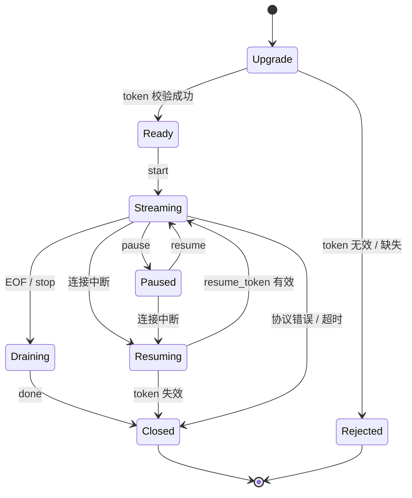
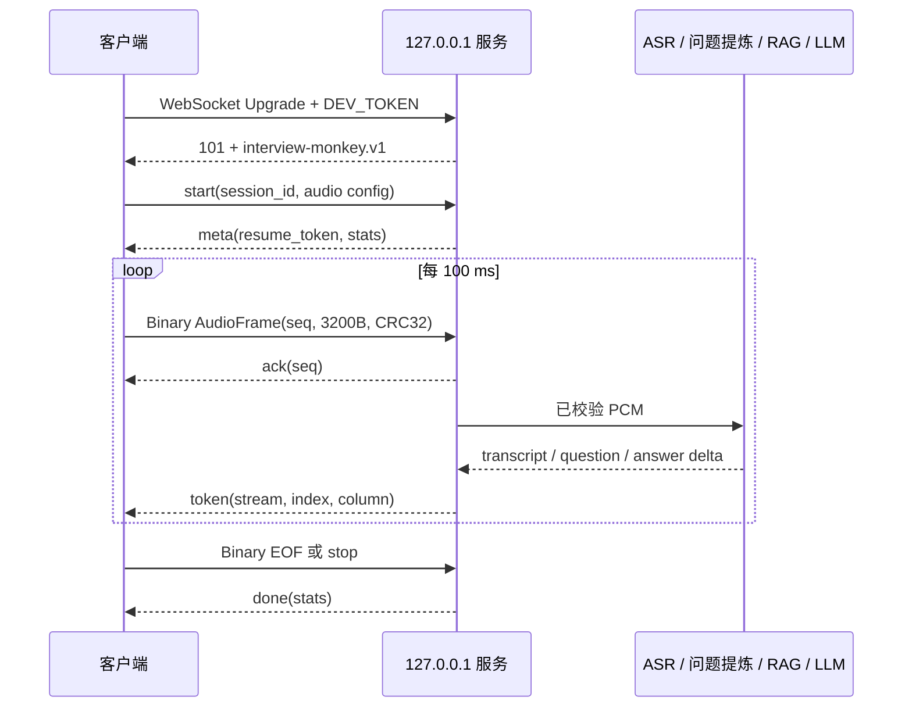

# 面试猴端云通信接口契约（v1）

> 本文把当前可观察到的 `/api/*` HTTP/SSE 行为与新增的 `/v1/realtime` WebSocket 契约分开记录。`/v1/realtime` 仅在 `realtime_server.py --mock` 中启用，用于协议和前端联调；默认真实流水线不注册该路由。

## 1. 现有行为与兼容边界

源码模式启动：`\.venv-pack\Scripts\python.exe realtime_server.py`，默认只绑定 `127.0.0.1:18765`，可用 `MH_REALTIME_PORT` 调整端口。桌面包使用本机随机回环端口。

现有客户端通过 HTTP 控制采集，并通过 SSE 接收转写、问题与回答：

| 用途 | 现有接口/事件 | 现状 |
|---|---|---|
| 状态 | `GET /api/status` | 返回采集状态及 `transport: sse` |
| 开始/停止采集 | `POST /api/capture/start`、`POST /api/capture/stop` | 开始请求包含 `mode`、可选设备和 `session_id`；没有独立 pause/resume HTTP 操作 |
| 转写、问题判定 | `GET /api/events` | SSE 事件名包括 `status`、`transcript`、`question_decision`、`answer` |
| 文本问答 | `POST /api/answer/stream` | SSE 事件名为 `meta`、`token`、`done`、`error`；`token.data` 目前只有 `delta`，`done.data` 包含 `status`、`metrics`，错误包含 `category`、`message`、`retryable`、`metrics` |

当前内部 `AudioFrame` 是 PCM16 little-endian 数据，包含 `timestamp_ms`、`channel`、`sample_rate` 和 `utterance_end`，会检查 PCM 字节数为偶数及采样率为正数。它不是网络帧协议，没有 `seq`、长度头或 CRC。

`JsonWebSocketASRProvider` 是服务端向可选 ASR 服务发起的 WebSocket 连接：当前适配器向该服务发送 JSON/Base64 `start`、`audio`、`utterance_end`、`stop`、`ping`，配置默认心跳间隔 15 秒、最多重连 5 次。它不是桌面客户端连入面试猴的接口，也不定义本文件的 v1 二进制帧格式。

**兼容原则：** 不更改上述 `/api/*` 路由、SSE 事件名或现有字段。新客户端协议只在 Mock 模式增加 `/v1/realtime`；新字段只出现在 v1 事件中。现有前端继续使用 SSE，Mock 模式通过固定 fixtures 填充相同事件名和字段，不调用真实 ASR/RAG/LLM。

## 2. v1 连接与认证

- WebSocket URL：`ws://127.0.0.1:<port>/v1/realtime`。仅允许回环地址；不提供公网监听。
- 子协议：`Sec-WebSocket-Protocol: interview-monkey.v1`。
- 握手认证：`Authorization: Bearer ${DEV_TOKEN}`。服务进程从环境变量读取本地开发令牌。当前 Uvicorn WebSocket 后端不支持自定义 denial response，因此缺失或无效令牌均以 HTTP 403 拒绝 Upgrade；两者在传输层无法区分，服务端内部审计仍区分 `AUTH_REQUIRED` / `AUTH_INVALID`，客户端应依据本机是否配置 `DEV_TOKEN` 判断修复方式。认证只在 `--mock` 新增的 v1 端点启用；旧 `/api/*` 继续维持现有本机开发接口。
- 不把令牌放在 URL、日志、会话事件或 fixtures 中；示例中的 `DEV_TOKEN_PLACEHOLDER` 是虚构占位值。
- v1 连接只使用 WebSocket 文本 JSON 控制帧/服务端事件，以及二进制音频帧。一次连接只承载一个 `session_id`。

经标准化供 Schema 校验的握手对象见 `schemas/handshake.schema.json`；实际线上传输是 HTTP Upgrade 头，不是 JSON 握手正文。

## 3. 控制帧

客户端 JSON 控制对象由 `schemas/control.schema.json` 校验。帧顺序为：认证握手、`start`、音频二进制帧与控制帧、`stop` 或 EOF。`pause` 暂停接收音频但保留会话；`resume` 从暂停或断线状态继续；`ack` 确认已处理的服务端 `event_index`；`ping` 请求同 nonce 的 `pong`。

`start.audio` 的默认参数为 16,000 Hz、单声道、`pcm_s16le`、100 ms 一帧。控制帧未知字段应忽略（便于向前扩展）；未知 `type` 返回 `INVALID_CONTROL`。

## 4. 二进制音频帧

默认帧是 100 ms、16 kHz、单声道、16-bit PCM：`16000 samples/s × 0.1 s × 2 bytes = 3200 bytes`。除 EOF 帧外，v1 每帧 payload 固定为 3200 字节。EOF 由 `flags.bit0=1` 表示，payload 长度为 0；EOF 帧本身也占用一个连续递增的 `seq`。

固定头长 36 字节。所有多字节整数均为 **little-endian**；payload 紧随头部：

| 偏移 | 长度 | 字段 | 编码/约束 |
|---:|---:|---|---|
| 0 | 4 | magic | ASCII `IMON` |
| 4 | 1 | version | `uint8`，当前为 1 |
| 5 | 1 | frame_type | `uint8`，音频为 1 |
| 6 | 2 | flags | `uint16`；bit 0 为 EOF，其余位必须为 0 |
| 8 | 4 | seq | `uint32`，每 session 从 0 连续递增 |
| 12 | 8 | timestamp_ms | `uint64`，单调递增的采集时间戳 |
| 20 | 4 | sample_rate | `uint32`，v1 固定为 16000 |
| 24 | 4 | payload_length | `uint32`；普通帧 3200，EOF 帧 0 |
| 28 | 1 | channel | `uint8`；mic=0、loopback=1 |
| 29 | 3 | reserved | 必须全 0 |
| 32 | 4 | crc32 | `uint32` little-endian，算法 CRC-32/ISO-HDLC |
| 36 | N | payload | 普通帧为 3200 字节 PCM；EOF 帧为空 |

CRC 输入为头部前 32 字节与 payload 拼接（不包含 CRC 字段）。校验失败不交付 ASR。JSON Schema 无法直接验证原始 WebSocket 二进制字节，因此 `schemas/audio_frame.schema.json` 校验其解码表示，验证脚本另行校验 Base64 payload 长度、头部编码和 CRC。

`seq` 缺号时返回 `SEQ_GAP` 并报告期望序号；CRC 错误返回 `CHECKSUM_MISMATCH`。相同 session 内已接收且 CRC 相同的旧序号可幂等确认，不得重复计入音频统计。

## 5. 心跳、重连与恢复

- 活跃会话每 15 秒发送一次应用层 `ping`，服务端返回同 nonce 的 `pong`。Mock 端默认 45 秒心跳超时可用 `MH_MOCK_HEARTBEAT_TIMEOUT_SECONDS` 缩短，仅用于故障联调。
- 连续 45 秒没有收到该 session 的有效控制帧、音频帧或 ping，服务端发送 `HEARTBEAT_TIMEOUT`（可发送时）并以 WebSocket close code `4408` 关闭。
- `meta` 下发随机 `resume_token`，只在本机进程内保存，有效期 600 秒。`start` 后先发送初始 `meta`（接收统计为零）；收到 EOF 或 `stop` 后再次发送 `meta`，其中 `received_bytes`、`audio_duration_ms` 和 `audio_duration_seconds` 是最终接收统计。断线后使用 `resume` 控制帧携带 token、`last_audio_seq` 和 `last_event_index`；服务端从确认位置恢复，不重复累计已确认音频。
- v1 Phase 2 Mock 的恢复范围是进程仍存活期间的内存态会话。服务重启后 token 失效，返回 `RESUME_EXPIRED`；不承诺跨进程持久化。
- 音频时长以实际接收的 PCM payload 字节数计算：`audio_duration_seconds = received_audio_bytes / (16000 × 2)`，`audio_duration_ms = received_audio_bytes / 32`。头部、控制帧和 EOF 帧不计入音频字节数；相同序号且 CRC 相同的重放帧不会重复计数。

## 6. 服务端事件

服务端以 WebSocket 文本 JSON 发送事件，统一通过 `schemas/server_event.schema.json` 校验。已认证 session 的所有服务端事件均带 `protocol_version=1`、`session_id` 和单调递增 `event_index`。

| `type` | 必需内容 | 处理方式 |
|---|---|---|
| `meta` | `trace_id`、`resume_token`、音频配置、接收统计 | `start` 后发送初始值；EOF/stop 后再次发送最终累计值 |
| `token` | `stream`、`index`、`delta`、`is_partial`、`column` | `stream` 为 transcript/question/answer；`column` 为 transcript/current_question/answer。转写/问题事件更新当前 utterance 内容；answer 的 delta 按序追加 |
| `done` | `stats` | EOF/stop 后发送最终字节、毫秒/秒时长、帧数、最后序号和耗时 |
| `error` | `code`、`message`、`retryable` | 返回稳定错误码；不得包含令牌或原始 PCM |
| `ack` | `seq`、`received_bytes` | 确认音频序号已校验和接收 |
| `pong` | `nonce` | 对客户端 ping 的响应 |

现有 SSE 的 `meta/token/done/error` 名称与 v1 一致，但其 payload 字段不完整。旧 SSE 使用 `schemas/legacy_sse_event.schema.json`；v1 使用 `schemas/server_event.schema.json`，两者不混为一个 schema。

## 7. 错误码与关闭码

| 错误码 | HTTP/WS 场景 | retryable | 说明 |
|---|---|---:|---|
| `AUTH_REQUIRED` | Upgrade 拒绝（当前 Uvicorn 返回 HTTP 403） | 否 | 服务端缺少 DEV_TOKEN；当前传输层与无效令牌共用状态码 |
| `AUTH_INVALID` | Upgrade 拒绝（当前 Uvicorn 返回 HTTP 403） | 否 | 客户端提供的 DEV_TOKEN 不匹配；当前传输层与缺失令牌共用状态码 |
| `INVALID_CONTROL` | error event / close 1008 | 否 | 控制 JSON 或状态不合法 |
| `INVALID_FRAME` | error event / close 4400 | 否 | magic、版本、保留位或字段非法 |
| `FRAME_TOO_LARGE` | error event / close 4400 | 否 | 音频帧长度超出契约 |
| `CHECKSUM_MISMATCH` | error event | 是 | CRC 校验失败，可重发期望序号 |
| `SEQ_GAP` | error event | 是 | 帧序号不连续，按返回序号补发 |
| `SESSION_NOT_FOUND` | error event | 否 | session_id 不存在 |
| `RESUME_EXPIRED` | error event | 否 | resume token 过期或进程已重启 |
| `HEARTBEAT_TIMEOUT` | error event / close 4408 | 是 | 心跳超时 |
| `RATE_LIMITED` | error event / close 1013 | 是 | 服务繁忙，稍后重试 |
| `INTERNAL` | error event / close 1011 | 可重试 | 未分类服务端错误；message 不泄露堆栈或凭据 |

WebSocket 标准关闭码 `1000` 表示正常结束；认证失败在升级前被拒绝（当前 Uvicorn 返回 HTTP 403）；协议错误和超时分别使用表中列出的应用关闭码。已完成 Upgrade 后的 `error` event 才会携带错误码；认证失败不会产生 WebSocket event。错误 event schema 限制 `code` 为上述枚举。

Mock 故障注入只对 `--mock` 生效：`MH_MOCK_DELAY_MS` 延迟各 fixture token；`MH_MOCK_DROP_SEQ` 在指定音频序号模拟丢帧并返回 `SEQ_GAP`；`MH_MOCK_DISCONNECT_AFTER_FRAMES` 在收到指定数量 PCM 帧后主动断开；`MH_MOCK_IGNORE_PING=1` 忽略 ping 以触发心跳超时；`MH_MOCK_ERROR_CODE` 在首个音频帧注入一个已登记错误码。默认配置不启用故障。

## 8. 状态机与数据时序





## 9. 契约与代码差异及处理决定

| 差异 | 处理决定 | 理由/兼容性 |
|---|---|---|
| 当前没有客户端 WebSocket、DEV_TOKEN 握手或二进制音频入口 | **仅在 `--mock` 下新增 `/v1/realtime`** | 当前交付协议仿真与联调入口；真实 ASR/RAG/LLM 路由保持不变 |
| 当前 AudioFrame 无 seq/CRC，内部 PCM 校验仅检查偶数长度和采样率 | **新建 v1 网络帧，不改内部 dataclass** | 网络边界做校验，避免污染现有 ASR 管线 |
| 现有 SSE token 只有 `delta`，缺 `stream/index/is_partial/column`；meta/done/error 字段也与 v1 不同 | **旧接口按现状建 legacy schema；新字段只进入 v1** | 兼容现有 `web/realtime.html` 消费逻辑 |
| 现有 ASR WebSocket 是服务端出站 JSON/Base64 协议，且有自己的 ping/重连 | **只描述为 provider 适配器，不把它宣称为客户端协议** | 两种方向、责任端和数据帧不同 |
| 现有 CaptureRuntime 管理单一采集运行态，不能代表 50 路协议 session | **Phase 2 Mock 新增独立会话隔离，不改真实采集默认行为** | 通过 `--mock`/配置开关隔离测试链路 |

## 10. 校验方法

安装 Schema 校验依赖并校验所有 JSON 示例：

```powershell
.\.venv-pack\Scripts\python.exe -m pip install -r contract\requirements.txt
.\.venv-pack\Scripts\python.exe contract\validate_contract.py
```

另开终端启动现有服务，再校验真实 `/api/answer/stream` SSE 输出（只连接回环地址；脚本不会打印回答正文）：

```powershell
.\.venv-pack\Scripts\python.exe realtime_server.py
```

```powershell
.\.venv-pack\Scripts\python.exe contract\validate_contract.py --live
```

`--live` 校验的是 legacy SSE Schema。v1 server event 的线上校验由 `tests/test_mock_protocol.py` 连接 `realtime_server.py --mock` 完成；50 路长时压力测试使用 `tests/sim_client.py`。
