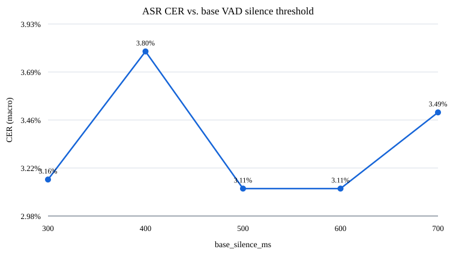

# 阶段 8：VAD 静音阈值网格搜索

- 样本数：33 条，本地两遍 ASR（Sherpa partial + SenseVoice final）
- 回放模式：快速离线；CER 可比较，延迟不作为实机指标
- 固定阈值：fast=300 ms，incomplete=700 ms
- 固定缓冲：pre-roll=200 ms，post-roll=150 ms
- 阶段 6 快速基线：CER=3.11%，术语召回=100.00%，问题准确率=100.00%。
- 搜索变量：`base_silence_ms`；其余 VAD、ASR、后处理参数保持当前配置。

## 本阶段实现

- 静音阈值保持自适应三档：快语速 300 ms、常规语速使用搜索参数、未完结句尾 700 ms；未完结标记覆盖“的、和、是、那个、就是”等。明确问号/感叹号结尾优先按完整句处理。
- `pre_roll_ms` 至少 200 ms，`post_roll_ms` 至少 150 ms；配置校验同时约束 fast ≤ base ≤ incomplete 且各阈值在 300–700 ms。
- 问题检测前合并间隔小于 1.5 秒、声道相同、说话人一致（若可识别）且前句没有句末语气的 final。完整句直接进入检测，避免额外等待。

## CER 曲线



| base silence (ms) | CER | 术语召回率 | 问题级准确率 | final 延迟 P50 (ms) |
|---:|---:|---:|---:|---:|
| 300 | 3.16% | 98.28% | 93.94% | 181 |
| 400 | 3.80% | 96.55% | 93.94% | 189 |
| 500 | 3.11% | 100.00% | 100.00% | 185 |
| 600 | 3.11% | 100.00% | 100.00% | 225 |
| 700 | 3.49% | 98.28% | 96.97% | 221 |

### 阶段 6 基线对比

| 版本 | CER | 术语召回率 | 问题级准确率 |
|---|---:|---:|---:|
| 阶段 6 快速基线 | 3.11% | 100.00% | 100.00% |
| 阶段 8 最优（base=500 ms） | 3.11% | 100.00% | 100.00% |

## 选择结果

CER 优先、术语召回和问题级准确率次序判定后，选出的 `base_silence_ms=500` ms，CER=3.11%。
若前几项完全相同，选择较短的 base 静音等待以减小响应延迟。该参数只更新 `vad.base_silence_ms`；fast/incomplete 继续采用配置值，未改变语速快句与未完结句的自适应分支。

## 限制与复现

本评测集现有 33 条样本全部为 TTS/加噪 TTS，没有人工校对的真人或会议环回音频。网格搜索结果是可复现工程对比，不代表真实会议环境的 CER 保证。
配置默认仍保留原值；网格搜索不会自动改写 `config/config.yaml`。确认参数后可手动把选择值写入 `vad.base_silence_ms`。

运行命令：

```powershell
.\.venv-pack\Scripts\python.exe -X utf8 eval\asr\tune_vad.py --values 300 400 500 600 700
```
